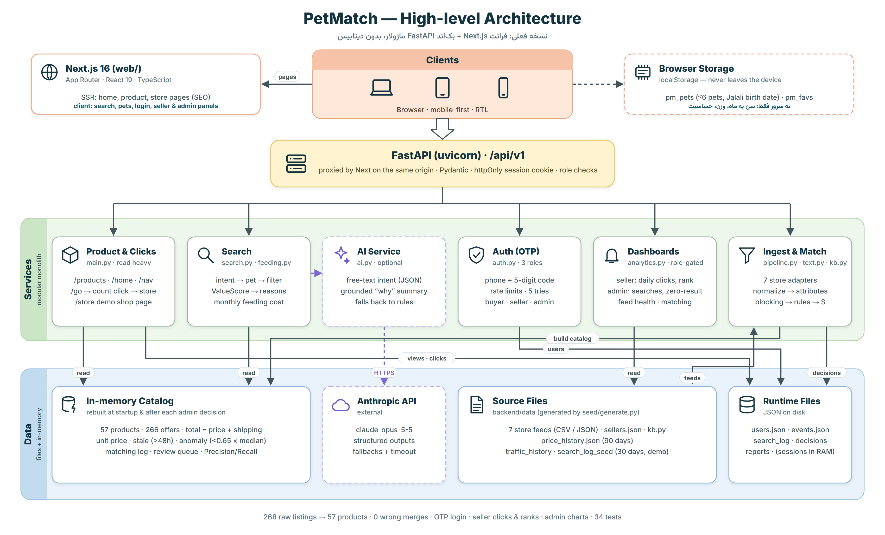

# پت‌مچ (PetMatch) — ترب برای محصولات حیوانات خانگی

> پروژه چالش **AI Product Engineer** ترب.
> بازار انتخابی: **غذا، خاک و تشویقی گربه و سگ**. این‌ها خریدهای تکرارشونده‌اند و مقایسه قیمت برایشان بیشترین ارزش را دارد.

```
$ build torob --for "pet supplies"
> crawl offers            ← ۷ فروشگاه، ۷ فرمت متفاوت (CSV/JSON، فارسی/انگلیسی، تومان/ریال)
> normalize messy data    ← ي/ك عربی، اعداد فارسی، نیم‌فاصله، «دو کیلویی»، «۳٬۱۹۰ هزار تومان»
> match same products     ← ۲۶۸ آگهی → ۵۷ محصول یکتا، صفر ادغام اشتباه، صف بررسی انسانی
> rank by user intent     ← زبان طبیعی + پروفایل حیوان + امتیاز ارزش خرید + هزینه ماهانه
> explain the best choice ← دلایل قابل‌استناد + خلاصه Claude (اختیاری)
> close the loop          ← کلیک به فروشگاه، پنل فروشنده، داشبورد جست‌وجوهای بی‌نتیجه
```

## مسئله

صاحب گربه‌ای که «غذای خشک ۲ کیلویی» می‌خواهد باید:

1. چند پت‌شاپ را بگردد.
2. مطمئن شود محصول‌ها واقعاً یکی‌اند (۴۰۰ گرم با ۲ کیلو فرق دارد، کیتن با بالغ هم).
3. هزینه ارسال را حساب کند.
4. بفهمد کدام قیمت قدیمی یا مشکوک است.

**ارزان‌ترین قیمت همیشه بهترین خرید نیست.** پت‌مچ این مراحل را در یک جست‌وجو انجام می‌دهد.

## اجرا

دو بخش دارد: بک‌اند پایتون (پورت ۸۰۰۰) و فرانت‌اند Next.js (پورت ۳۰۰۰). در دو ترمینال جدا اجرا کنید:

```bash
cd backend
pip install -r requirements.txt
python seed/generate.py          # فقط اولین بار: ساخت فیدها و آمار نمایشی
python -m uvicorn app.main:app --port 8000
```

```bash
cd web
npm install
npm run dev                      # یا برای نسخه production: npm run build && npm start
```

سپس `http://localhost:3000` را باز کنید. فرانت‌اند درخواست‌های `/api/*` را به بک‌اند می‌فرستد، پس کوکی ورود بدون CORS کار می‌کند. آدرس بک‌اند را می‌شود با متغیر `BACKEND_URL` عوض کرد.

| مورد | توضیح |
|---|---|
| ورود | `/login` با موبایل و کد یک‌بارمصرف. در حالت نمایشی پیامک ارسال نمی‌شود: کد به‌شکل یک «پیامک» روی صفحه نشان داده و خودکار وارد می‌شود |
| بدون لاگین | در حالت نمایشی لازم نیست وارد شوید: `/seller` و `/admin` را مستقیم باز کنید؛ با حساب نمایشی همان نقش وارد می‌شوید (بدون کد). در هدر پنل می‌شود بین پت‌کده، پنجه طلا و مدیر جابه‌جا شد. خرید، حیوان من و علاقه‌مندی‌ها هم بدون حساب کار می‌کنند |
| حساب‌های نمایشی | خریدار `09120000001` · فروشنده پت‌کده `09120000002` · فروشنده پنجه طلا `09120000005` · مدیر `09120000003` (روی صفحه ورود با یک کلیک) |
| حالت نمایشی OTP | با `PETMATCH_DEMO_OTP=0` خاموش می‌شود؛ در آن صورت کد هیچ‌وقت در پاسخ API برنمی‌گردد و ورود بدون کد هم وجود ندارد |
| قابلیت‌های AI | با تنظیم `ANTHROPIC_API_KEY` فعال می‌شوند. بدون آن هم کل محصول با قواعد کار می‌کند |
| تست‌ها | `cd backend && python -m pytest -q tests` (۳۶ تست) · `cd web && npx tsc --noEmit` |

## صفحه‌ها و امکانات

| صفحه | چه دارد |
|---|---|
| **خانه** | بنر اسلایدی «تا X٪ اختلاف قیمت» که عددش از داده محاسبه می‌شود، جست‌وجوی هوشمند با مثال، دسته‌ها، پرطرفدارها، بیشترین اختلاف قیمت، برندها، راهنمای خرید. روی سرور رندر می‌شود (SEO) |
| **نتایج جست‌وجو** | چیپ‌های «فهمیدیم دنبال این هستی»، کارت «بهترین انتخاب» با دلیل‌ها، پنج نوع مرتب‌سازی (از جمله «کمترین هزینه ماهانه»)، فیلترهای کناری، انتخاب حیوان فعال |
| **صفحه محصول** | گالری، مشخصات، منبع داده، کادر خرید، هزینه تغذیه برای حیوان فعال، مقایسه فروشگاه‌ها با قیمت نهایی، هشدار قیمت مشکوک، نمودار ۹۰ روزه، گزارش قیمت اشتباه. عنوان و توضیح روی سرور رندر می‌شوند |
| **خرید از فروشگاه** | هر کلیک از `/api/v1/go/{listing}` رد می‌شود و ثبت می‌شود، بعد **صفحه نمایشی همان فروشگاه** با رنگ و ظاهر خودش باز می‌شود |
| **ورود و ثبت‌نام** | موبایل + کد یک‌بارمصرف ۵ رقمی، با شمارنده انقضا و ارسال دوباره. ثبت‌نام خریدار یا فروشنده (مدیر از فرم عمومی ساخته نمی‌شود) |
| **پنل‌ها جدا از سایت** | پنل فروشنده و مدیر هدر خودشان را دارند: بدون نوار جست‌وجوی خرید، منوی گربه/سگ/برندها، «حیوان من» و فوتر؛ فقط منوی پنل، جابه‌جایی حساب نمایشی، «مشاهده سایت» و خروج |
| **پنل فروشنده** | کلیک امروز در برابر دیروز، کلیک و بازدید ۳۰ روزه با نمودار روزانه، CTR، هشدارهای قیمت و موجودی، پرکلیک‌ترین محصولات، جدول «محصولات شما در برابر رقبا» (جایگاه قیمت، فاصله با ارزان‌ترین رقیب) |
| **افزودن محصول (فروشنده)** | `/seller/products`: عنوان، دسته، وزن، قیمت، موجودی و لینک. همان‌طور که تایپ می‌کنید، **پیش‌نمایش تطبیق** با پایپ‌لاین واقعی نشان می‌دهد سیستم چه فهمید (برند، سن، وزن، مدل) و محصول به کدام محصول موجود وصل می‌شود، محصول جدید می‌شود یا به صف بررسی مدیر می‌رود. بعد از ثبت، قیمت و موجودی همان‌جا ویرایش یا محصول حذف می‌شود |
| **پنل مدیریت** | تب داشبورد: جست‌وجوی روزانه و بی‌نتیجه، جست‌وجوهای بی‌نتیجه (فرصت توسعه)، کلیک روزانه، سهم کلیک فروشگاه‌ها، نتیجه تطبیق، تازگی قیمت‌ها، دسته‌ها، سلامت فید فروشگاه‌ها، کاربران. تب تطبیق: صف بررسی انسانی و نمونه یکسان‌سازی داده خام |
| **پروفایل حیوان‌ها** | تا ۶ حیوان با تاریخ تولد شمسی؛ سن هر بار از امروز محاسبه می‌شود و پیشنهادها با بزرگ شدن حیوان عوض می‌شوند |
| **هزینه ماهانه تغذیه** | با وزن حیوان: روزی چند گرم، هر بسته چند هفته، ماهی چقدر. تخمینی است و این در صفحه نوشته شده |

طراحی **mobile-first** و **راست‌چین** است، با فونت Vazirmatn و نوار ناوبری پایین در موبایل. همه تصاویر SVG ساخت خود پروژه‌اند.

## تصمیم‌های کلیدی محصول

| تصمیم | چرا |
|---|---|
| مرتب‌سازی پیش‌فرض «بهترین ارزش خرید»، نه «ارزان‌ترین» | قیمت هر کیلو، هزینه ارسال، اعتبار فروشنده و تناسب با حیوان از قیمت خام مهم‌ترند |
| «تومان در ماه» کنار «تومان به ازای هر کیلو» | ارزان‌ترین کیلو لزوماً کمترین خرج ماهانه نیست، و بسته‌ای که ۳۰ هفته طول می‌کشد شاید تا آخرش تازه نماند |
| قیمت نهایی (کالا + ارسال) در همه صفحه‌ها | کاربر پول نهایی را می‌پردازد |
| در تطبیق، False Positive از False Negative بدتر است | ادغام اشتباه یعنی خرید اشتباه؛ هر جا اطلاعات حیاتی ناقص باشد از انسان می‌پرسیم |
| قیمت‌های خیلی پایین (۳۵٪+ زیر میانه) و قدیمی (۴۸ ساعت+) پیشنهاد اول نمی‌شوند | این‌ها معمولاً خطای داده یا قیمت طعمه‌اند |
| ورود با OTP، بدون رمز عبور | برای کاربر ایرانی آشناتر است و رمزی برای نشت کردن نداریم |
| کلیک خروجی از سرور رد می‌شود | هم ارزش ما برای فروشنده قابل اندازه‌گیری می‌شود (پنل فروشنده)، هم پایه مدل درآمدی ارجاع |
| فروشنده جایگاه قیمتش را در برابر رقبا می‌بیند | انگیزه فروشنده برای به‌روز نگه داشتن قیمت و موجودی، یعنی داده بهتر برای خریدار |
| جست‌وجوهای بی‌نتیجه در داشبورد مدیر | حلقه یادگیری: کاربران «قلاده» و «اسباب‌بازی» می‌خواهند و ما نداریم؛ این دسته بعدی است |
| Next.js با رندر سمت سرور برای صفحه‌های عمومی | بیشتر ترافیک سایت‌های مقایسه قیمت از موتورهای جست‌وجو می‌آید |
| پروفایل و علاقه‌مندی‌ها روی دستگاه کاربر | به سرور فقط «سن به ماه»، وزن و حساسیت‌ها می‌رود؛ نام و تاریخ تولد نه |
| AI فقط در دو نقطه | جست‌وجوی آزادی که قواعد نفهمیدند، و توضیحی که فقط به داده‌های محاسبه‌شده تکیه دارد |
| پرداخت داخلی وجود ندارد | کاربر به فروشگاه هدایت می‌شود و ریسک مالی حذف می‌شود |

## فرمول‌ها در یک نگاه

- **شباهت دو آگهی:** `S = 0.40·نام + 0.20·برند + 0.25·وزن + 0.15·نوع`
  - `S ≥ 0.95` → ادغام خودکار · `0.75 ≤ S < 0.95` → صف بررسی انسانی · `S < 0.75` → محصول جدید
  - اگر آگهی جدید مدل، طعم یا رایحه‌ای داشته باشد که محصول موجود ندارد → محصول مشخص‌تر و جداگانه
- **ارزش خرید:** `ValueScore = 0.35·P + 0.25·Q + 0.20·R + 0.20·C`
  - P قیمت هر کیلو · Q تناسب با حیوان · R اعتبار فروشنده · C قیمت در برابر میانه بازار
- **هزینه ماهانه:** `RER = 70 × وزن^0.75` × ضریب سن و عقیم بودن ÷ انرژی هر گرم غذا

برای ایجنت‌های کدنویسی: [AGENT.md](AGENT.md) نقشه پروژه است (هر فایل چه می‌کند، اجرا، قواعد) و [.claude/skills/petmatch/SKILL.md](.claude/skills/petmatch/SKILL.md) دستورالعمل کارهای رایج؛ لازم نیست هر بار کل پروژه اسکن شود.


**دیاگرام‌ها:**
- [architecture.png](architecture.png): معماری فعلی (Clients ← Next.js ← FastAPI ← Services ← Data)
- [architecture_production.png](architecture_production.png): معماری هدف برای نسخه واقعی
- [data_flow.png](data_flow.png): مسیر داده و دیتاست‌ها



## ساختار پوشه‌ها

```
backend/
  app/main.py        API (جست‌وجو، محصول، ورود، کلیک، پنل فروشنده، پنل مدیر)
  app/auth.py        ورود با موبایل و OTP، نشست با کوکی httpOnly، نقش‌ها
  app/analytics.py   بازدید، کلیک و لاگ جست‌وجو (داده نمایشی ۳۰ روزه + رویدادهای زنده)
  app/pipeline.py    ورود داده، اعتبارسنجی، تطبیق، ساخت کاتالوگ
  app/text.py        یکسان‌سازی متن فارسی/انگلیسی و استخراج ویژگی
  app/kb.py          واژه‌نامه برندها و ویژگی‌ها
  app/search.py      فهم نیت کاربر، فیلتر، رتبه‌بندی، دلیل‌ها
  app/feeding.py     هزینه ماهانه تغذیه
  app/ai.py          Claude (اختیاری)
  seed/generate.py   فیدهای خام نامرتب، برچسب مرجع، آمار نمایشی
  tests/             ۳۶ تست
web/                 Next.js 16 (App Router، TypeScript)
  app/(site)/        صفحه‌های سایت با هدر فروشگاهی: خانه، جست‌وجو، محصول، حیوان من، ورود، ثبت‌نام
  app/(panel)/       پنل‌ها با هدر جدا: فروشنده (داشبورد، افزودن محصول) و مدیر
  app/store/         صفحه نمایشی فروشگاه (ظاهر جدا از پت‌مچ)
  components/        هدر، کارت محصول، نمودارهای SVG، OTP، ...
  lib/               API، وضعیت کاربر و حیوان‌ها، تصاویر SVG
```

## تفاوت نسخه نمایشی با محصول واقعی

| نسخه نمایشی | محصول واقعی |
|---|---|
| ۷ فروشگاه ساختگی و ۲۶۸ آگهی تولیدشده، با خطاهای واقعی‌نما | قرارداد فید با ۳ تا ۵ پت‌شاپ، سپس API |
| کد OTP در پاسخ API (بدون پیامک) | سرویس پیامک؛ کد هیچ‌وقت در پاسخ نیست |
| نشست‌ها در حافظه، کاربران و رویدادها در فایل JSON | PostgreSQL برای کاربران، Redis برای نشست و rate limit، جدول رویداد یا pipeline تحلیلی |
| آمار ۳۰ روزه ساختگی (به‌علاوه رویدادهای واقعی همین اجرا) | رویدادهای واقعی |
| جست‌وجوی درون‌حافظه | Meilisearch |
| اجرای پایپ‌لاین هنگام بالا آمدن سرور | Celery و Redis با زمان‌بندی بر اساس پرفروش بودن محصول |

> فروشگاه‌ها، قیمت‌ها، آمار و لینک‌ها ساختگی‌اند و این در خود سایت هم نوشته شده است.
